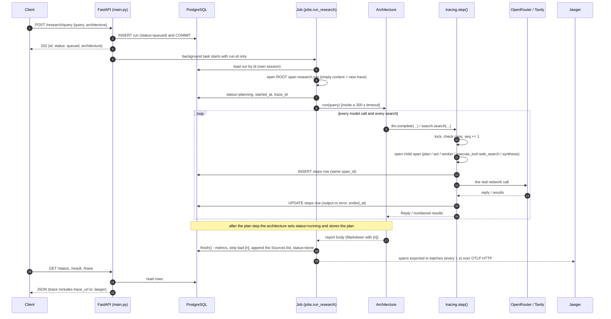
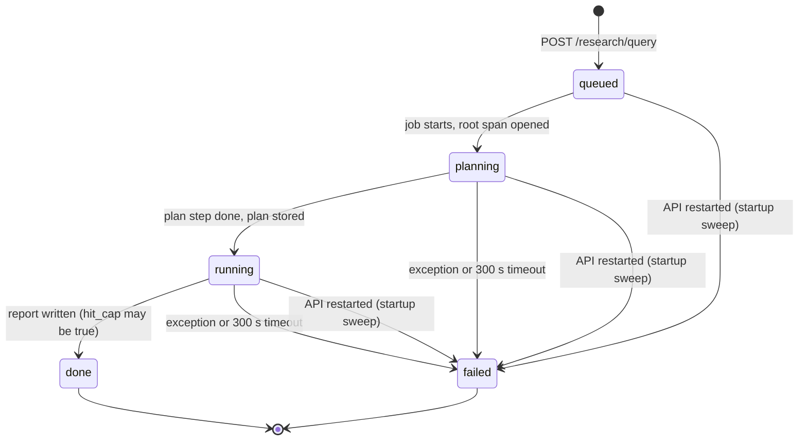
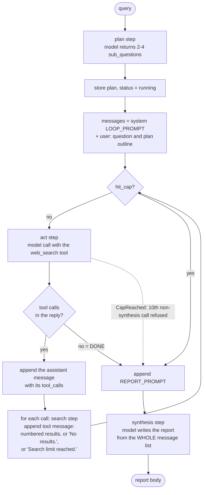
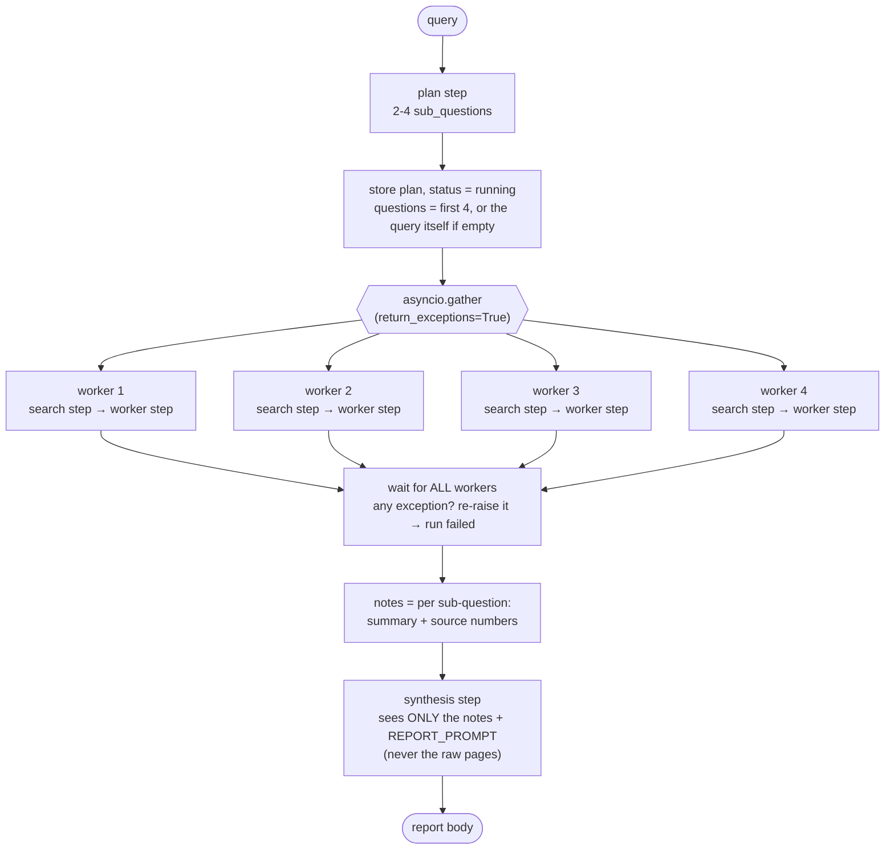
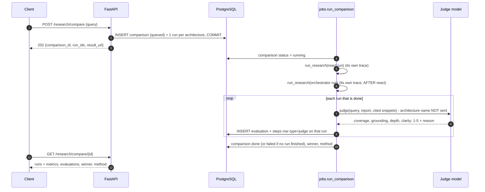
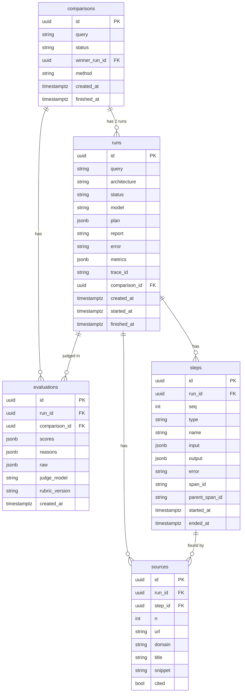

# Deep Research API

A FastAPI + PostgreSQL service that takes a question, runs a **deep research agent in the
background** (plan → search the web → write a cited report), stores everything, and records every
step as an **OpenTelemetry trace** you can open in Jaeger. Two agent **architectures** do the
research (`react` and `orchestrator`). A **comparison** runs both on the same question and has a
second model judge the reports.

This README explains the whole system from scratch: the flow, the traces and spans, and both
architectures. Setup and the route list are at the end ([Run it](#16-run-it)).

---

## Contents

1. [The 30-second pitch](#1-the-30-second-pitch)
2. [Words you need (from zero)](#2-words-you-need-from-zero)
3. [System map](#3-system-map)
4. [The life of one run](#4-the-life-of-one-run)
5. [`tracing.step()`: the heart of it](#5-tracingstep-the-heart-of-it)
6. [What is on each span](#6-what-is-on-each-span)
7. [Architecture 1: `react`](#7-architecture-1-react)
8. [Architecture 2: `orchestrator`](#8-architecture-2-orchestrator)
9. [react vs orchestrator side by side](#9-react-vs-orchestrator-side-by-side)
10. [Sources and citations](#10-sources-and-citations)
11. [Comparison and the judge](#11-comparison-and-the-judge)
12. [The database](#12-the-database)
13. [Design decisions (ADRs) in one line each](#13-design-decisions-adrs-in-one-line-each)
14. [Questions your mentor may ask](#14-questions-your-mentor-may-ask)
15. [Cheat sheet](#15-cheat-sheet)
16. [Run it](#16-run-it)

---

## 1. The 30-second pitch

- **You send a question** with `POST /research/query`. You get a run id back **at once** (HTTP 202).
  The research happens in a background job.
- **The agent plans** (2 to 4 sub-questions), **searches** the web with Tavily, and **writes** a
  Markdown report with `[n]` citations, using an OpenRouter model.
- **Every model call and every search is a "step".** Each step is written **twice**: as a row in the
  `steps` table and as a **span** in an OpenTelemetry trace. `GET /research/{id}/trace` and Jaeger
  show the same list. (One exception: the judge step of a compared run is in `/trace`, but Jaeger
  shows it as a separate trace.)
- **Two architectures** answer the same way from the outside but differ in **who decides the next
  step**. In `react` the **model** decides (a loop, so the trace is a chain). In `orchestrator` the
  **code** decides (parallel workers, so the trace fans out and in).
- **`POST /research/compare`** runs both, one after the other, counts metrics, has a **blind
  judge model** score each report from 1 to 5, and picks a winner with a fixed rule.

> One sentence: *"A FastAPI service that runs two research-agent designs in the background with the
> same model, tools and limits, and records every step both in Postgres and as an OpenTelemetry
> trace, so you can compare them fairly and see exactly what each one did."*

---

## 2. Words you need (from zero)

### Research words

| Word | Meaning here |
|---|---|
| **Run** | One attempt by one architecture to answer one query. A row in `runs`. It ends `done` with a report or `failed` with an error. |
| **Architecture** | One control structure for a run: `react` or `orchestrator`. Both use the same model, search tool, caps and report template. |
| **Step** | One unit of work in a run: **one model call** or **one search**. A row in `steps` **and** a span. |
| **Plan** | The first step of every run. The model splits the question into 2 to 4 sub-questions (JSON). |
| **Act** | (`react` only) One model call that either asks for a search (a tool call) or stops. |
| **Worker** | (`orchestrator` only) One sub-question handled on its own: 1 search, then 1 model call that returns a short summary with source numbers. |
| **Synthesis** | The final model call that writes the report. |
| **Source** | One web page a search returned. It gets a number `n`, unique within the run. A row in `sources`. |
| **Citation** | A marker `[n]` in the report pointing to source number `n`. |
| **Cap** | The most a run may do: **10 model calls, 6 searches**. Separately, a **300 second time limit** applies to the whole run. |
| **`hit_cap`** | True when the call or search cap refused a step. The run still writes its report and is `done`, not `failed`. The time limit is different: the run is cancelled and ends `failed` with `"time limit"`, with no report. |

### Observability words

| Word | Meaning here |
|---|---|
| **Trace** | The full story of one run: all its spans. **One run = one trace.** |
| **Span** | One timed piece of work inside a trace: a name, a start, an end, and **attributes** (labels). |
| **Root span** | The span with no parent. Here it is **`research.run`**, one per run. |
| **Parent / child span** | A child is opened while its parent is the "current" span. **Every step span is a direct child of `research.run`.** |
| **Trace id** | The 32-hex id shared by all spans of one trace. Stored on the run (`runs.trace_id`). |
| **Span id** | The 16-hex id of one span. Stored on the matching `steps` row (`steps.span_id`). That is how the database and Jaeger line up. |
| **Attribute** | A key/value on a span, such as `gen_ai.request.model` or the search query. |
| **OpenTelemetry (OTel)** | The standard library for making spans. We use the Python SDK. |
| **OTLP exporter** | The OTel part that sends finished spans over HTTP to `OTEL_EXPORTER_OTLP_ENDPOINT` (`:4318`). |
| **Jaeger** | The trace viewer in docker compose, at http://localhost:16686. It keeps traces in memory only. |

```
 TRACE (trace_id = 4bf92f35...)            one research run (a short react run)
 │
 └── SPAN research.run  (root, no parent)  start ──────────────────────────────────── end
       ├── SPAN plan                        ▕██▏
       ├── SPAN act                             ▕██▏          model asks for a search
       ├── SPAN execute_tool web_search             ▕███▏
       ├── SPAN act                                      ▕██▏  model stops
       └── SPAN synthesis                                    ▕██████▏
            ▲
            └─ each of these = 1 row in the `steps` table with the same span_id
```

---

## 3. System map

```
 ┌──────────┐  HTTP   ┌─────────────────────────── one API process ──────────────────────────────┐
 │  client  │────────▶│ app/main.py  FastAPI: 7 routes                                           │
 │ curl/e2e │◀────────│   POST /research/query → insert run (queued), COMMIT, add_task → 202     │
 └──────────┘  202 +  │                     │ BackgroundTasks (same process, no queue)           │
              run id  │                     ▼                                                    │
                      │ app/jobs.py  run_research(run_id)                                        │
                      │   opens root span research.run, 300 s timeout, then finish()             │
                      │                     │                                                    │
                      │                     ▼                                                    │
                      │ app/agents/  react.run(query)   or   orchestrator.run(query)             │
                      │                     │                                                    │
                      │       ┌─────────────┴──────────────┐   the ONLY two doors to the world   │
                      │       ▼                            ▼                                     │
                      │ app/llm.py                    app/search.py                              │
                      │  complete() ─▶ call_openrouter  search() ─▶ call_tavily                  │
                      │       │                            │                                     │
                      │       └───────────┬────────────────┘                                     │
                      │                   ▼                                                      │
                      │ app/tracing.py  step(): check caps → open span → write steps row         │
                      └───────────┬───────────────────────────────┬──────────────────────────────┘
                                  │ SQLAlchemy async + asyncpg    │ BatchSpanProcessor (every 1 s)
                                  ▼                               ▼ OTLP over HTTP :4318
                      ┌───────────────────────┐        ┌────────────────────────┐
                      │ PostgreSQL 18         │        │ Jaeger  :16686 (UI)    │
                      │ runs, steps, sources, │        │ in-memory trace store  │
                      │ comparisons, evals    │        └────────────────────────┘
                      └───────────────────────┘
           external:  OpenRouter (model calls)     Tavily (web search)
```

| File | One line |
|---|---|
| `app/main.py` | The 7 routes. Creates rows, commits, queues the background job. A startup hook fails stale runs. |
| `app/jobs.py` | `run_research` (one run), `finish` (report + metrics + source list), `run_comparison`, `fail_stale_runs`. |
| `app/agents/__init__.py` | `ARCHITECTURES = {"react": (description, run), "orchestrator": (...)}`: the registry. |
| `app/agents/react.py` | The loop architecture (~60 lines). |
| `app/agents/orchestrator.py` | The fan-out/fan-in architecture (~70 lines). |
| `app/llm.py` | `complete()`: every model call, recorded as a step, retried once on bad JSON. Shared `PLAN_PROMPT` and `REPORT_PROMPT`. |
| `app/search.py` | `search()`: every web search, recorded as a step. Numbers new sources and stores them. The `web_search` tool definition. |
| `app/tracing.py` | The tracer, the caps, the current-run object, and `step()` (span + row together). |
| `app/evaluate.py` | Metrics counted in code, the judge call, the winner rule. |
| `app/db.py` | Engine, session factory, the 5 tables. |
| `app/schemas.py` | Pydantic request/response bodies. |

**The key rule of the design:** an architecture never talks to OpenRouter, Tavily, the database or
OpenTelemetry directly. Every model call goes through `llm.complete(...)` and every search through
`search.search(...)`. Apart from those, an architecture uses only `tracing.update_run` (to store
the plan and set the status), `tracing.CapReached`, and react's read of `hit_cap`. The two doors
call `tracing.step()`. So **every step is recorded, capped and traced in exactly one place**, and both
architectures are measured the same way.

---

## 4. The life of one run

### 4.1 Sequence



### 4.2 Status of a run



### 4.3 The same thing in bullets

- **Route** (`main.submit`): builds a `Run` row with `status="queued"` and `model=LLM_MODEL`,
  **commits it first**, then `background_tasks.add_task(jobs.run_research, run.id)`.
  - Why commit first: the job loads the run **by id in its own session**. If the row were not
    committed, the job would not find it. The job never gets a session or an ORM object, only the id.
- **Job** (`jobs.run_research`):
  - Opens the root span `research.run` with `context=Context()` (an **empty** context), so the run
    is **a trace of its own**, not a child of the HTTP request. Attributes: `run.id`,
    `run.architecture`, `run.query`.
  - Creates `tracing.Run(id=run_id)` (the in-memory counters) and puts it in a ContextVar.
  - Sets `status="planning"`, `started_at`, and `trace_id` (from the root span).
  - Calls the architecture inside `asyncio.timeout(300)`.
  - On success: `finish()`. On **any** exception: span status ERROR, `status="failed"`,
    `error=` the message, or `"time limit"` if the 300 s ran out.
- **Architecture**: plan → research → synthesis (details in sections 7 and 8). After the plan
  it writes `plan` and `status="running"`.
- **`finish()`**, one transaction:
  - Loads the run's stored sources.
  - `evaluate.metrics()` marks the cited sources, **removes `[n]` markers that point to no
    source**, and counts the metrics.
  - Appends `## Sources` **written by the service** from the stored rows (only the cited ones).
  - Sets `status="done"`, `report`, `metrics`, `finished_at`.
- **Startup sweep** (`lifespan` → `jobs.fail_stale_runs`): a job lives inside the API process, so
  after a restart any `queued/planning/running` run can never finish. It is set to `failed` with
  `"the API restarted during the run"`. Unfinished comparisons are failed too.

---

## 5. `tracing.step()`: the heart of it

Every model call (`llm._call`) and every search (`search.search`) runs inside
`async with tracing.step(kind, name, input, span_name) as (row, span):`.

```
 tracing.step(kind, name, input)
 │
 ├─ 1. async with run.lock:                         (one lock per run, parallel workers share it)
 │      ├─ which counter?  kind == "search"     → searches  ≤ 6
 │      │                  kind == "synthesis"  → llm_calls ≤ 10
 │      │                  any other model call → llm_calls ≤ 9   ◀── keeps 1 call for the report
 │      ├─ counter at cap?  → run.hit_cap = True ; raise CapReached
 │      └─ counter += 1 ; run.seq += 1 ; seq = run.seq
 │
 ├─ 2. tracer.start_as_current_span(span_name or kind)      → the SPAN opens (child of research.run)
 │
 ├─ 3. INSERT steps row  (run_id, seq, type=kind, name, input,
 │                         span_id = this span's id,
 │                         parent_span_id = research.run's span id,
 │                         started_at)                       → its own short DB session
 │
 ├─ 4. yield (row, span)   ── the caller does the network call here and sets row.output
 │                            and span attributes
 │      └─ on any exception (even a cancel/timeout): row.error = the message, then re-raise
 │
 └─ 5. finally: UPDATE steps row (output, error, ended_at)   → its own short DB session
        span closes when the `with` block ends
```

**Why every step span hangs directly under `research.run` (no deeper nesting):**

- Inside a step there is only a network call, never another step. **Within one task**, a step's
  span closes before that task's next step opens.
- Parallel orchestrator workers are separate tasks. `asyncio.gather` gives each one **its own copy
  of the context**, where the current span is `research.run`. Their spans overlap in time, but none
  is ever the current span in another worker's context.
- So when any step starts, the current span is `research.run`, and every step's parent is
  `research.run`.
- **"Chain" and "fan-out" describe the timing on the Jaeger timeline, not the tree depth.** In both
  architectures the tree is flat: root + N children.

**Why one shared `tracing.Run` object (the ContextVar trick):**

- `tracing.current` is a `ContextVar` holding one `Run` dataclass with the counters: `seq`,
  `llm_calls`, `searches`, tokens, `cost_usd`, `hit_cap`, `sources` (url → n), and a `lock`.
- `asyncio.gather` gives each task **a copy of the context**. The copy still points at the **same
  object**, so every worker updates the same counters (under the lock).
- That is why `current.set()` is called only once at the start of each run (`jobs.run_research`)
  and once before each judge call, **never inside an architecture or a worker**. A worker that set
  a new object would only change its own copy, and the counts would be lost.

**Why caps live here and not in the architectures:** one place enforces the same limits for both
architectures, so the comparison is fair. A new architecture cannot forget them.

---

## 6. What is on each span

| Span name | `steps.type` | Made by | Key attributes |
|---|---|---|---|
| `research.run` | (no row: it is the run) | `jobs.run_research` | `run.id`, `run.architecture`, `run.query`; status ERROR if the run failed |
| `plan` | `plan` | `llm.complete(step="plan")` | `gen_ai.operation.name=chat`, `gen_ai.request.model`, `gen_ai.response.model`, `gen_ai.usage.input_tokens`, `gen_ai.usage.output_tokens`, `output`, `citations` |
| `act` | `act` | react loop | same model attributes; `output` is the reply text, or the tool calls as JSON when the text is empty (the `steps` row always has the full tool calls) |
| `execute_tool web_search` | `search` (name `web_search`) | `search.search()` | `gen_ai.operation.name=execute_tool`, `gen_ai.tool.name=web_search`, `gen_ai.tool.call.arguments` (the query), `gen_ai.tool.call.result` (n, url, title of each result); on failure: the exception and status ERROR |
| `worker` | `worker` | orchestrator worker | same model attributes |
| `synthesis` | `synthesis` | both | same model attributes; `citations` = the `[n]` numbers in the report |
| `judge` | `judge` | `evaluate.judge()` | same model attributes; **its own one-span trace** (section 11) |

- The attribute names follow the OpenTelemetry **GenAI semantic conventions** (`gen_ai.*`), so a
  tracing tool knows which spans are model calls and which are tool calls.
- **Span attributes are cut at 1,000 characters** (`SpanLimits`). The `steps` rows keep the
  **full** prompt and reply. Jaeger is for the shape and timing, the database for the full text.
- **A retry is its own step.** If a reply is not valid JSON or does not match the schema,
  `llm.complete` retries once. You then see **two** spans/rows of the same type, the first with an
  `error`. Both count against the cap (ADR 0008), so `llm_calls` = the number of model steps.
- **A failed search does not fail the run.** It becomes a step with an `error` and returns no
  results. The agent continues.
- **The provider is a module object, not the global one.** So FastAPI's own HTTP request spans are
  off, and the trace contains only research steps.
- Spans are recorded **even with no exporter** (empty `OTEL_EXPORTER_OTLP_ENDPOINT`), so every run
  still gets a real trace id and real span ids in the database.

---

## 7. Architecture 1: `react`

> **Idea:** one agent in a loop. **The model** decides at each turn: search again, or stop.
> ("ReAct" = Reason + Act: think, call a tool, read the result, repeat.)

### 7.1 Flow



### 7.2 Code walk (`app/agents/react.py`)

- **Plan**: `llm.complete([...PLAN_PROMPT, query], step="plan", schema=llm.Plan)`. The reply is
  validated by Pydantic: `{"sub_questions": [...]}`.
- `tracing.update_run(plan=..., status="running")`.
- **Message list**: a system prompt ("search one thing at a time... reply DONE without a tool call
  when done") + the question + the plan as bullet points.
- **Loop**: `while not tracing.current.get().hit_cap:`
  - `reply = llm.complete(messages, step="act", tools=[search.TOOL])`. Only `tool_choice="auto"`
    is sent: the model may or may not call the tool.
  - **No tool calls → `break`.** That is the model saying "done".
  - Otherwise append the assistant message (with its `tool_calls`), then run **each** tool call
    with `use_tool()` and append a `tool` message with the numbered results.
  - `use_tool()`: a missing query → an error text back to the model; a search refused by the cap →
    `"Search limit reached."` (and `hit_cap` is now true, so the loop ends at the next check).
- **`except tracing.CapReached: pass`**: after 1 plan + 8 acts (9 non-synthesis calls), the next
  `act` is refused and the loop stops.
- **Synthesis**: append `REPORT_PROMPT` to the **same growing message list** and call
  `llm.complete(messages, step="synthesis")`. The writer sees every search result the loop saw.

### 7.3 What the trace looks like in Jaeger: a chain

```
 research.run  ├──────────────────────────────────────────────────────────────────────────┤
 plan          ├────┤
 act                 ├───┤                                     model: "search X"
 execute_tool             ├─────┤                              Tavily
 act                             ├────┤                        model: "search Y"
 execute_tool                          ├─────┤
 act                                         ├───┤             model: "search Z"
 execute_tool                                    ├─────┤
 act                                                   ├──┤    model: no tool call → DONE
 synthesis                                                 ├───────────────┤  the report
                                                                                    time ─▶
 Every bar starts after the previous one ends. Every bar is a direct child of research.run.
```

### 7.4 Numbers and limits

- **Worst case at the caps:** 1 `plan` + up to 8 `act` = 9 non-synthesis calls, then 1 `synthesis`
  = **10 model calls**; at most **6 searches**. A retry uses one of those calls.
- The context **grows every turn** (every result's page text, up to 4,000 characters each, stays in
  the message list), so later calls cost more tokens.
- **Strength:** adapts. It can follow up on what it found and stop early on easy questions.
- **Weakness:** sequential, so slower (dry run: about **89 s**). It can stop too early or wander.
  The context keeps growing.

---

## 8. Architecture 2: `orchestrator`

> **Idea:** a planner splits the question, **one worker per sub-question runs at the same time**,
> and one writer combines the findings. **The code** decides the steps; no model loop chooses
> what to do next.

### 8.1 Flow (fan-out, fan-in)



One worker:

```
 work(question)
   ├─ results = search.search(question)          ── span: execute_tool web_search
   │    └─ no results (or the search failed) ──▶ return EMPTY  (no model call)
   ├─ reply = llm.complete(WORKER_PROMPT + numbered sources,
   │                       step="worker", schema=Findings)        ── span: worker
   │    └─ reply: {"summary": "2-4 sentences with [n]", "source_numbers": [1, 2]}
   └─ CapReached anywhere ──▶ return EMPTY       (the writer still runs)
```

### 8.2 Code walk (`app/agents/orchestrator.py`)

- **Plan**: the same `plan` step and the same `PLAN_PROMPT` as react (fair comparison).
- `questions = plan["sub_questions"][:MAX_SUB_QUESTIONS] or [query]` with `MAX_SUB_QUESTIONS = 4`.
- **Fan-out**: `asyncio.gather(*(work(q) for q in questions), return_exceptions=True)`.
  - `return_exceptions=True`: a plain gather raises at the **first** failure and leaves the other
    workers running unwatched. Here **all workers finish first**, then the code re-raises the
    first exception. So **a failed worker fails the run**, after the others are done.
  - Only a **model** failure gets there (network error, or bad JSON twice). A failed search
    returns `[]`, so its worker gives empty findings.
- **Each worker has its own messages**: its sub-question + its own numbered sources. The source
  numbers `[n]` are **global for the run** (handed out under the shared lock), so worker 2's `[7]`
  means the same page everywhere.
- **Fan-in**: build `notes` ("### sub-question / summary / Sources: 1, 3") and call
  `llm.complete(question + notes + REPORT_PROMPT, step="synthesis")`.
  - The writer **never sees the raw pages**, only the short findings. That keeps its context
    small, but detail can be lost in the hand-off.

### 8.3 What the trace looks like in Jaeger: fan-out, fan-in

```
 research.run  ├──────────────────────────────────────────────────────────────┤
 plan          ├────┤
 execute_tool        ├─────┤                         worker 1 search  ┐
 execute_tool        ├───────┤                       worker 2 search  │
 execute_tool        ├────┤                          worker 3 search  │ FAN-OUT:
 execute_tool        ├──────┤                        worker 4 search  │ the bars
 worker                   ├────────┤                 worker 3 summary │ OVERLAP
 worker                    ├───────┤                 worker 1 summary │ in time
 worker                       ├──────┤               worker 4 summary │
 worker                         ├────────┤           worker 2 summary ┘
 synthesis                                ├──────────────┤   FAN-IN: one writer
                                                                         time ─▶
 Inside one worker the search bar ENDS before its worker bar starts: they are
 siblings (both children of research.run), not parent and child.
```

- In the `steps` table the `seq` numbers of the workers **interleave** (for example search, search,
  search, search, worker, worker, ...), because they run at the same time.

### 8.4 Numbers and limits

- **Budget:** 1 `plan` + up to 4 `worker` + 1 `synthesis` = **at most 6 model calls** (plus
  retries); **at most 4 searches**. It normally stays well inside the caps (10 and 6).
- **Strength:** parallel, so faster (dry run: about **35 s**). Predictable cost. Each worker's
  context is small and focused.
- **Weakness:** only as good as the plan's split. One search per sub-question, no follow-up. The
  writer sees summaries, not pages.

---

## 9. react vs orchestrator side by side

| | `react` | `orchestrator` |
|---|---|---|
| **Idea** | One agent in a loop | Planner + parallel workers + one writer |
| **Who decides the next step** | **The model**, every turn | **The code** (the planner's split, then fixed fan-out/fan-in) |
| **Searches** | 0 to 6, chosen by the model, one after another | 1 per sub-question (at most 4), all at once |
| **Model calls** | plan + n × act + synthesis (at most 10) | plan + up to 4 workers + synthesis (at most 6) |
| **Context** | One growing message list with all results | Each worker has its own; the writer sees short findings |
| **Stop rule** | The model stops calling the tool, or a cap | All workers have returned |
| **Trace shape** | **Chain**: bars one after another | **Fan-out / fan-in**: overlapping bars, then one |
| **Tree depth** | Flat: every step is a child of `research.run` | Flat: every step is a child of `research.run` |
| **Dry-run latency** | ~89 s | ~35 s |
| **Fails when** | Many sub-topics; context grows; stops early | The split is vague; the hand-off loses detail |

**What is the same in both (that is what makes the comparison fair):** the same model
(`LLM_MODEL`), the same `PLAN_PROMPT`, the same `web_search` tool (Tavily, 5 results, 4,000
characters per page), the same caps, the same `REPORT_PROMPT`, the same metrics. **Only the
control structure differs.**

```
 react:         plan ─▶ act ─▶ search ─▶ act ─▶ search ─▶ act ─▶ synthesis        (a chain)

 orchestrator:              ┌─▶ search ─▶ worker ─┐
                plan ─▶ ────┼─▶ search ─▶ worker ─┼───▶ synthesis                  (fan-out / fan-in)
                            ├─▶ search ─▶ worker ─┤
                            └─▶ search ─▶ worker ─┘
```

---

## 10. Sources and citations

```
 Tavily results (url, title, snippet, page text ≤ 4,000 chars)
        │
        ▼  search.search(), under run.lock
 ┌───────────────────────────────────────────────────────────────┐
 │ url already in run.sources?  yes → keep its first number n     │
 │                              no  → n = len(run.sources) + 1    │
 │                                    new `sources` row (n, url,  │
 │                                    domain, title, snippet,     │
 │                                    step_id = this search step) │
 └───────────────────────────────────────────────────────────────┘
        │  results go to the model as "[n] title / url / text"
        ▼
 the model writes the report body with [n] markers
        │
        ▼  jobs.finish() → evaluate.metrics()
 ┌───────────────────────────────────────────────────────────────┐
 │ every [n] found in the report:                                 │
 │   n is a stored source  → mark it cited = true                 │
 │   n is NOT stored       → count it as invalid, REMOVE it       │
 │ citation_validity = valid markers / all markers (0 if none)    │
 └───────────────────────────────────────────────────────────────┘
        │
        ▼
 the service appends "## Sources" with ONLY the cited stored rows:
   - [1] [Page title](https://...)
```

- **The model never writes the source list.** So a URL in the report is always a URL that was
  really retrieved (ADR 0005). The model cannot make one up.
- The lock matters for `orchestrator`: 4 workers storing sources at the same time cannot give two
  pages the same number.
- `[` and `]` inside a page title are escaped, so a title like "Report [7]" cannot create a fake
  citation.
- A list like `[1, 2]` is not parsed as a citation (a known shortcut); the prompts ask for one
  number per bracket.

---

## 11. Comparison and the judge



- **One after the other, never in parallel**: so each run's latency is its own (no contention)
  and the free-tier rate limit holds.
- **Metrics, counted in code** (`evaluate.metrics`): `latency_s`, `llm_calls`, `searches`,
  `prompt_tokens`, `completion_tokens`, `cost_usd` (OpenRouter's `usage.cost`), `sources_found`,
  `sources_cited`, `domains_cited`, `citation_validity`, `words`, `hit_cap`.
- **The judge** (`evaluate.judge`):
  - Uses `JUDGE_MODEL`, from **another model family** than `LLM_MODEL` (less self-preference).
  - **Blind:** it sees the question, the report and the cited sources' snippets, **not** the
    architecture name.
  - Scores **coverage, grounding, depth, clarity** from 1 to 5, each with a one-line reason.
    "Do not reward length."
  - Validated with Pydantic (`score` must be 1 to 5); retried once if invalid.
- **The judge's trace:** the judge runs after `research.run` has ended, so there is no current
  span. Its `judge` span becomes **a one-span trace of its own**. The `steps` row is stored on the
  judged run (seq continues, `parent_span_id` null), so `/trace` lists it, but Jaeger shows it
  **outside** the run's trace.
- **The judge does not count in the run's metrics:** it gets a **fresh `tracing.Run`** object, so
  the run's caps cannot block it and its tokens are not added to the run (ADR 0009).
- **Winner rule `judge_mean_v1`:** the highest **mean** of the 4 scores; a tie → the higher
  `citation_validity`; a tie again → the lower `latency_s`. Cost and latency are shown, not scored.
- A failed judge call → that evaluation is missing; the winner is picked from the others (or none).
- **Limits of the method:** no reference answers, a small query set, one judge not calibrated
  against humans, the judge reads snippets not full pages, one run per architecture per query (no
  variance estimate), and `citation_validity` checks that a source exists, not that it supports
  the claim.

---

## 12. The database



- **The bridge to Jaeger:** `runs.trace_id` = the trace id, and `steps.span_id` /
  `steps.parent_span_id` = the span ids. So `GET /research/{id}/trace` returns the same tree
  Jaeger draws, plus a `trace_url` (`http://localhost:16686/trace/<trace_id>`).
- `sources` has a unique `(run_id, url)`: one row per page per run.
- Status columns are plain strings. Migrations: Alembic, one revision creates the five tables.
- Every write uses **its own short session**, and parallel workers never share one.

---

## 13. Design decisions (ADRs) in one line each

The full text is in `docs/adr/`.

| ADR | Decision | Why |
|---|---|---|
| 0001 | **Plain Python agents**, no LangGraph or CrewAI | The control structure is what we compare, so it must be readable line by line. |
| 0002 | **In-process `BackgroundTasks`**, no queue | Smallest stack (API + Postgres). Cost: a restart loses running jobs; one process only. |
| 0003 | **One helper writes the step row and the span**; a run is its own trace | `/trace` and Jaeger never disagree; the DB keeps steps after Jaeger forgets them. |
| 0004 | **Caps checked only in `tracing.step()`**, and the last call is kept for the report | Same limits for every architecture; a capped run is `done` with `hit_cap`, not `failed`. |
| 0005 | **The service writes the source list** | No invented URLs; bad `[n]` markers are counted, then removed. |
| 0006 | **Counted metrics + one blind pointwise judge + a fixed winner rule** | Fair and repeatable; pairwise judging is the next step. |
| 0007 | **Compare is async** (202 + poll) | A comparison takes minutes. |
| 0008 | **Each retry is its own step** and counts against the cap | `llm_calls` always matches the model steps in `/trace`. |
| 0009 | **The judge step is outside the run's trace and metrics** | Judging is not research work; metrics are frozen when the run ends. |
| 0010 | **Two architectures** (`reflection` removed) | They differ on the two axes that matter: who decides (model vs code) and the call graph (chain vs fan-out). |

---

## 14. Questions your mentor may ask

**"Walk me through what happens when I POST a query."**
→ The route inserts a `queued` run and commits it, queues a background task with only the run id,
and returns 202. The task opens the root span `research.run` as a new trace, stores the trace id,
runs the architecture inside a 300 s timeout, then `finish()` stores the report, metrics and
source list and sets `done`. Any exception sets `failed` with the reason.

**"What is the difference between a trace and a span?"**
→ A span is one timed operation (one model call, one search). A trace is all the spans of one
run, linked by one trace id, with `research.run` as the root.

**"Why are all spans direct children of the root? Shouldn't the worker's search be under the
worker?"**
→ `tracing.step()` opens and closes each step's span around one network call, and a step never
contains another step. So the current span is always `research.run` when a step starts. A worker
is a function, not a span. Its search and its model call are siblings in the tree. The chain or
fan-out shows up in **time**, not in nesting.

**"How do you get the same steps in the API and in Jaeger?"**
→ One helper, `tracing.step()`, opens the span **and** writes the `steps` row with that span's
id, for every step. Nothing can be in one and not the other.

**"How do the two architectures really differ?"**
→ In react the model chooses each next search and when to stop: a loop, one growing context, a
chain trace. In orchestrator the code splits the work into up to 4 parallel workers and one
writer: fixed steps, small separate contexts, a fan-out/fan-in trace.

**"How do you keep the comparison fair?"**
→ Same model, plan prompt, search tool, caps and report template. Every call goes through the same
two functions. The runs go one after the other. The judge is blind to the architecture and from
another model family.

**"What happens when a cap is hit?"**
→ `tracing.step()` raises `CapReached` and sets `hit_cap`. Non-synthesis calls stop at 9, so call
10 is always left for the report. react stops looping; an orchestrator worker returns empty
findings. The run is still `done`, with `hit_cap: true`.

**"How do parallel workers not corrupt counters or source numbers?"**
→ One shared `Run` object (in a ContextVar, the same object in every gather task) and one
`asyncio.Lock` around every counter or numbering change. Each DB write has its own session.

**"What if the model returns broken JSON?"**
→ Pydantic validation fails (a `ValueError`), and `llm.complete` retries once. Both attempts are
steps; the first has the error. A second failure raises and fails the run (in orchestrator,
after the other workers finish).

**"How do you know a citation is real?"**
→ Sources are numbered by the service when retrieved. `finish()` keeps only `[n]` that match a
stored source and removes the others, `citation_validity` measures the share, and the service
writes `## Sources` itself. It proves the source exists, not that it supports the claim (a known
limit).

**"What happens if the server restarts mid-run?"**
→ The job is lost (it lives in the process). At startup every unfinished run and comparison is set
to `failed`. The upgrade is a queue with a worker (and then several processes would be safe).

**"Why no LangChain/LangGraph?"**
→ The architectures exist to be compared, so their control flow must be visible in ~60 lines each,
and nothing may sit between them and the shared caps and recording.

**"How is cost tracked?"**
→ Each model reply's `usage` (prompt tokens, completion tokens, OpenRouter's `cost`) is added to
the run's counters under the lock and stored in `metrics`. The tokens are also span attributes.

**"How would you scale this?"**
→ A queue (for example Postgres-backed or Redis) with separate workers; share one HTTP client;
real auth; Jaeger with persistent storage; more queries and pairwise judging for the evaluation.

---

## 15. Cheat sheet

- **Trace** = the full story of one research run. One trace id per run, stored on the run. Jaeger
  shows it at `http://localhost:16686/trace/<trace_id>` (the `trace_url` from `GET /research/{id}/trace`).
- **Span** = one timed piece of work: one model call or one web search. A start, an end, and labels
  (model, tokens, the search query, the URLs found).
- **Root span** = `research.run`, the parent of every step span in that run. It is opened with an
  empty context, so it is not a child of the HTTP request.
- **Step** = every step span is also a row in `steps` with the **same span id**. One helper,
  `tracing.step()`, writes both. That is why `/trace` and Jaeger show the same list (except the
  judge step, which Jaeger shows as its own trace).
- **Span names:** `plan`, `act`, `execute_tool web_search`, `worker`, `synthesis`, `judge`.
- **react trace:** plan → act → search → act → search → … → act (no tool call) → synthesis.
  **A chain.** The model decides each next step and when to stop.
- **orchestrator trace:** plan → up to 4 workers **at the same time** (each 1 search, then 1
  `worker` call) → one synthesis. The worker bars **overlap** on the timeline (fan-out); the single
  synthesis is the fan-in. **The code decides the steps, not the model.**
- **Nesting:** in both, every step span hangs **directly** under `research.run`. "Chain" and
  "fan-out" describe **time**, not deeper nesting.
- **Caps:** 10 model calls (non-synthesis stop at 9, so the report always gets written) and 6
  searches. A capped run is `done` with `hit_cap: true`. The **300 s time limit** is different: the
  run is `failed` with `"time limit"` and has no report.
- **Statuses:** queued → planning → running → done / failed.
- **Citations:** the service numbers sources, removes fake `[n]`, writes `## Sources` itself.
- **Judge:** scores each report (coverage, grounding, depth, clarity, 1 to 5) **after** the run has
  finished, blind to the architecture, with a model from another family. It gets **its own
  one-span trace** outside the run's trace, and it is not counted in the run's metrics.
- **Winner:** the highest mean score → then higher `citation_validity` → then lower latency.
- **Two doors:** every model call is `llm.complete`, every search is `search.search`. That one
  rule gives recording, caps and tracing for free.

---

## 16. Run it

You need Python 3.12+, [uv](https://docs.astral.sh/uv/), Docker, curl and jq.

```bash
uv sync                                   # install
docker compose up -d                      # PostgreSQL 18 and Jaeger
cp .env.example .env                      # then put your keys in .env
uv run alembic upgrade head               # create the tables
uv run --env-file .env fastapi dev app/main.py --no-reload
uv run pytest -q                          # in a second terminal; needs Docker, no keys
```

The API listens on `http://localhost:8000`; the interactive docs are at `/docs`. Without
`--no-reload`, a file change reloads the app and kills a running job.

### Environment

Keys come only from environment variables. `.env` is in `.gitignore`. `.env.example` uses
`<your-key>` as the placeholder.

| Variable | Meaning |
|---|---|
| `OPENROUTER_API_KEY` | Key for model calls (https://openrouter.ai/keys). |
| `LLM_MODEL` | OpenRouter model id for both architectures. Empty: the free default `nvidia/nemotron-3-super-120b-a12b:free`. |
| `JUDGE_MODEL` | Model id of the judge, from another family. Empty: the free default `dots-studio/dots-3-note-preview:free`. |
| `TAVILY_API_KEY` | Key for web search (https://app.tavily.com, free tier 1,000 searches a month). |
| `DATABASE_URL` | Must start with `postgresql+asyncpg://`. `.env.example` matches `docker-compose.yml`. |
| `OTEL_EXPORTER_OTLP_ENDPOINT` | Where spans go. `http://localhost:4318` is the Jaeger container. Empty: no export. |
| `OTEL_SERVICE_NAME` | The service name Jaeger shows (`deep-research-api`). |

### The 7 routes

| Method | Route | Success | Errors |
|---|---|---|---|
| POST | `/research/query` | 202 `{id, status, architecture}` | 422 |
| GET | `/research/{id}/status` | 200 status and timestamps | 404 |
| GET | `/research/{id}/result` | 200 report, sources, metrics | 404; 409 if not `done` |
| GET | `/research/{id}/trace` | 200 plan, ordered steps, trace id and link | 404 |
| GET | `/research/architectures` | 200 `[{name, description}]` | |
| POST | `/research/compare` | 202 `{comparison_id, run_ids, result_url}` | 422 |
| GET | `/research/compare/{id}` | 200 runs, evaluations, winner, method | 404 |

```bash
BASE=http://localhost:8000
curl -s -X POST $BASE/research/query -H 'Content-Type: application/json' \
  -d '{"query": "How do HTTP/2 and HTTP/3 differ?", "architecture": "orchestrator"}'
RUN=<run-id>
curl -s $BASE/research/$RUN/status        # queued, planning, running, done or failed
curl -s $BASE/research/$RUN/result        # 409 until done
curl -s $BASE/research/$RUN/trace         # plan, steps, trace_id, trace_url
curl -s -X POST $BASE/research/compare -H 'Content-Type: application/json' \
  -d '{"query": "How do HTTP/2 and HTTP/3 differ?"}'
curl -s $BASE/research/compare/<comparison-id>
```

All 7 in one go: `BASE=http://localhost:8000 bash scripts/e2e.sh`.

**Viewing traces:** open Jaeger at http://localhost:16686, choose the service `deep-research-api`,
and search, or open the `trace_url` directly.

### Questions and assumptions

- One comparison fits free tiers: at most 24 model calls (10 per run, plus up to 2 judge calls per
  run when a judge reply is retried) and at most 10 searches (6 react + 4 orchestrator).
- 202 plus a GET is acceptable for compare. There are no reference queries; we use our own.
- Quality decides the winner; cost and latency are shown, not scored.
- No authentication, no deployment, no UI. A malformed id gives 422, an unknown id 404.

### Known limits

- **A restart loses a running job** (it lives in the API process). **One API process only.**
- **No authentication or rate limiting.** `trace_url` always points to `http://localhost:16686`.
- **Free models** allow about 20 requests a minute and are retired often (`app/llm.py`).
- **The caps cut research short** (`hit_cap`). At 300 seconds the run fails with `time limit`.
- **A failed worker fails the `orchestrator` run**, after the other workers finish.
- **Page text is cut at 4,000 characters** (`app/search.py`). **`[1, 2]` is not parsed as citations.**
- **The tests use a fake model and search.** They prove structure, caps, traces and the contract,
  not research quality.
