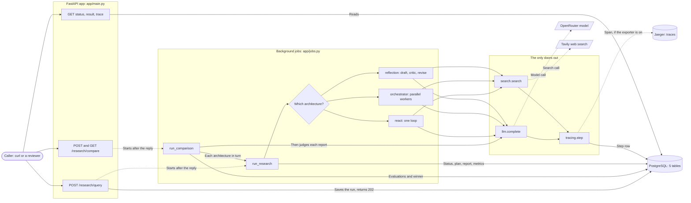
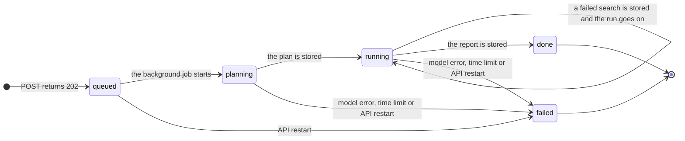
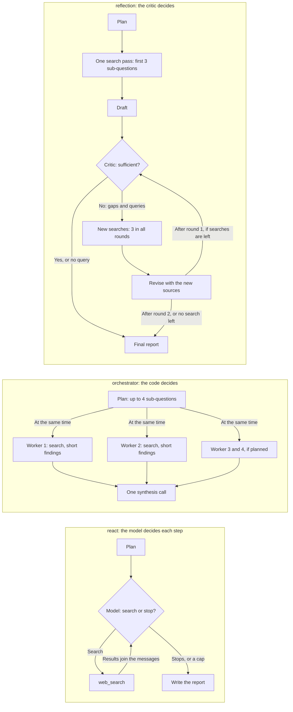
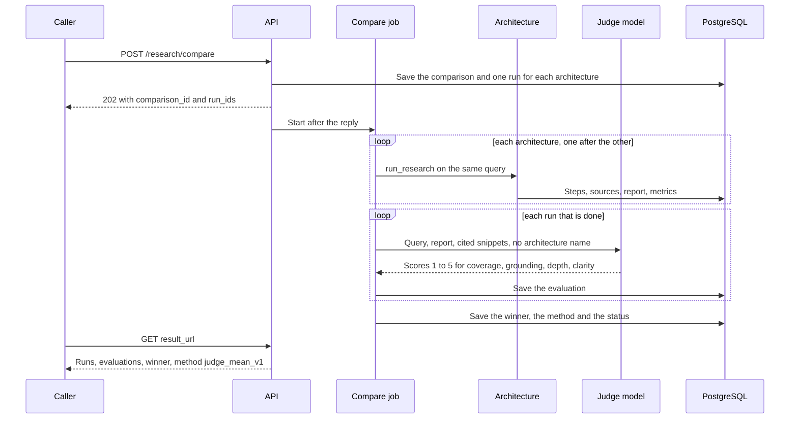
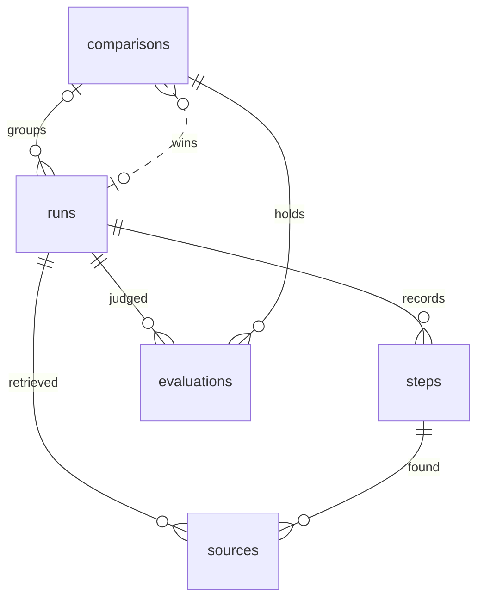

# Deep Research API

## 1. What it is

A FastAPI service with a PostgreSQL database that runs a deep research agent in the background. A
caller sends one query and gets a run id at once. The service plans, searches the web and writes a
report with numbered citations. Every run, step, source and report is stored, and every run is one
OpenTelemetry trace. There is no UI and no authentication.

The research can be done by three agent architectures that differ in structure: `react`,
`orchestrator` and `reflection`. `POST /research/compare` runs all three on the same query, judges
the reports with a second model and stores the metrics, the scores and a winner. The specification
is `SPEC.md`; requirement ids (`R1`...) and decisions (`D1`...) in this file refer to it.

Where the code is:

- `app/main.py`: the seven routes. `app/jobs.py`: the background jobs. `app/agents/`: one file for
  each architecture.
- `app/llm.py` and `app/search.py`: the only doors to the model and to web search.
  `app/tracing.py`: the caps and `step()`, which writes a span and a `steps` row together.
- `app/evaluate.py`: the counted metrics, the judge and the winner rule. `app/db.py`: the five
  tables. `migrations/`: Alembic.
- `tests/`: contract tests with a fake model and a fake search (no network). `scripts/e2e.sh`: a
  curl walk through all seven routes.

## 2. Quick start

You need Python 3.12+, [uv](https://docs.astral.sh/uv/), Docker, curl and jq.

```bash
uv sync                                   # install the dependencies
docker compose up -d                      # PostgreSQL 18 and Jaeger; wait a few seconds
cp .env.example .env                      # then put your keys in .env, see section 3
uv run alembic upgrade head               # create the five tables
uv run --env-file .env fastapi dev app/main.py
uv run pytest -q                          # in a second terminal
```

Put two keys into `.env`: `OPENROUTER_API_KEY` and `TAVILY_API_KEY`. Replace `<your-key>` with the
real value. With a free key, also empty `LLM_MODEL` and `JUDGE_MODEL` in `.env`. The API listens on `http://localhost:8000`; the interactive docs are at `/docs`.

Notes:

- `fastapi dev` reloads when a file changes, and a reload kills the running job. Add `--no-reload`
  for a long run.
- The tests use the compose database `research_test` and a fake model and search, so they need
  Docker but no keys. Set `TEST_DATABASE_URL` to use another database.
- `docker compose up -d` creates `research_test` the first time it starts a new PostgreSQL.

## 3. Environment

Keys come only from environment variables (R15). `.env` is never committed: it is in `.gitignore`.
`.env.example` lists the names with `<your-key>` as the placeholder.

| Variable | Meaning | Where the value comes from |
|---|---|---|
| `OPENROUTER_API_KEY` | Key for the model calls. | Create one at https://openrouter.ai/keys |
| `LLM_MODEL` | OpenRouter model id for all three architectures. | The model list of OpenRouter. Empty: the free default `nvidia/nemotron-3-super-120b-a12b:free`. |
| `JUDGE_MODEL` | OpenRouter model id of the judge. Use another model family than `LLM_MODEL`. | The model list of OpenRouter. Empty: the free default `dots-studio/dots-3-note-preview:free`. |
| `TAVILY_API_KEY` | Key for web search. | Create one at https://app.tavily.com (free tier: 1,000 searches each month). |
| `DATABASE_URL` | PostgreSQL URL. It must start with `postgresql+asyncpg://`. | The value in `.env.example` matches `docker-compose.yml`. |
| `OTEL_EXPORTER_OTLP_ENDPOINT` | Where spans are sent (OTLP over HTTP). | `http://localhost:4318` is the Jaeger container. Empty: no exporter. |
| `OTEL_SERVICE_NAME` | The service name that Jaeger shows. | Free text. |

`.env.example` names a paid pair of models, from two families. With both model lines empty, the
service uses the free defaults of `app/llm.py`. They were chosen on 13 Oct 2026 from the free models
that list `tools` and `structured_outputs`, and they suit a reviewer with a free key. Free models
allow about 20 requests a minute and change often, so a comparison on them takes minutes and the
default may need to be picked again (see section 9).

If Tavily answers with an error (for example 432, the plan limit), the search step stores the error
and the run goes on with no sources from that search. Such a report has no citations.

## 4. The seven routes

The API has no key. `BASE` is the address of the server.

| Method | Route | Success | Errors |
|---|---|---|---|
| POST | `/research/query` | 202 `{id, status, architecture}` | 422: empty query or unknown architecture |
| GET | `/research/{id}/status` | 200 status and timestamps | 404 |
| GET | `/research/{id}/result` | 200 report, sources, metrics | 404; 409 `{status, error}` if the run is not `done` |
| GET | `/research/{id}/trace` | 200 plan, ordered steps, trace id and link | 404 |
| GET | `/research/architectures` | 200 `[{name, description}]` | |
| POST | `/research/compare` | 202 `{comparison_id, run_ids, result_url}` | 422 |
| GET | `/research/compare/{id}` | 200 runs, evaluations, winner, method | 404 |

```bash
BASE=http://localhost:8000

# 1. Start a run. "architecture" is optional: react (the default), orchestrator or reflection.
curl -s -X POST $BASE/research/query -H 'Content-Type: application/json' \
  -d '{"query": "How do HTTP/2 and HTTP/3 differ?", "architecture": "react"}'
# {"id": "<run-id>", "status": "queued", "architecture": "react"}

RUN=<run-id>   # the id from the answer above

# 2. Status: queued, planning, running, done or failed, with timestamps and the error if any.
curl -s $BASE/research/$RUN/status

# 3. Result: the report, its sources, the model and the metrics. 409 until the run is done.
curl -s $BASE/research/$RUN/result

# 4. Trace: the plan, every step with input and output, the trace id and the Jaeger link.
curl -s $BASE/research/$RUN/trace

# 5. The architectures that the service has.
curl -s $BASE/research/architectures

# 6. Compare: three runs on one query, one after the other, then the judge. Takes minutes.
curl -s -X POST $BASE/research/compare -H 'Content-Type: application/json' \
  -d '{"query": "How do HTTP/2 and HTTP/3 differ?"}'
# {"comparison_id": "<id>", "run_ids": {"react": "<run-id>", ...}, "result_url": "/research/compare/<id>"}

CMP=<comparison-id>   # the comparison_id from the answer above

# 7. The stored comparison. Poll it until "status" is done (or failed).
curl -s $BASE/research/compare/$CMP
```

`POST /research/compare` returns 202 and not the comparison: three research jobs take minutes, and
research must not block a request. If one run fails, the comparison is completed over the runs that
finished. It is `failed` only when no run finished.

To call all seven routes in one go: `BASE=http://localhost:8000 bash scripts/e2e.sh`. It needs curl
and jq, prints one line for each call, exits 1 if a status or a body is wrong, and takes several
minutes because it includes one comparison.

## 5. How to view traces

Jaeger runs in the compose stack. Open http://localhost:16686, choose the service
`deep-research-api` (the value of `OTEL_SERVICE_NAME`) and search. Or call
`GET /research/{id}/trace`: its `trace_url` is the direct link to the trace of that run.

One run is one trace. The root span `research.run` has no parent and carries the run id, the
architecture and the query. Every step is a child span of it:

- a model call is a span named after its step: `plan`, `act`, `worker`, `critique`, `synthesis`,
  `synthesis draft` or `synthesis revise`. It has the OpenTelemetry GenAI attributes
  (`gen_ai.operation.name`, `gen_ai.request.model`, `gen_ai.usage.input_tokens`,
  `gen_ai.usage.output_tokens`), the model's answer and the citation numbers it used. The plan text is
  on the `plan` span.
- a search is an `execute_tool web_search` span with the query and the URLs and titles that came back.
- a failed step has the error on its span.

Long attribute values are cut at 1,000 characters in the span. The `steps` rows keep the full text.

The `/trace` route answers from the database, not from Jaeger. Its `steps` carry the same `span_id`
values as the spans, so the two views show the same steps. Jaeger keeps traces in memory only: they
are gone when the container restarts. The database keeps the steps (decision D5).

The judge call of a comparison is a step on the judged run, but its span is a trace of its own: it
starts after `research.run` has ended (D18).

## 6. Architectures and evaluation

### What the three share

All three use one model (`LLM_MODEL`), one search tool, the same caps and the same report template.
Only the control structure differs, so a comparison compares architectures.

- Caps for each run: 10 model calls, 6 searches, 300 seconds (D20). A model call that is not a `synthesis`
  step (the plan, a critique, a worker, an `act` turn) stops one call early, so a run at the cap can still
  write its report (D11).
- Each run starts with a `plan` step. The plan is stored on the run.
- The report has a title, a summary, findings with numbered citations `[n]`, and limits and open
  questions (600 to 1,000 words). The service writes the source list itself from the stored sources,
  so a cited URL is always a retrieved URL (D10). A `[n]` with no stored source is counted and then
  removed from the report.
- No agent framework: each architecture is one short file that can be read line by line (D2).

### The architectures

| | `react` | `orchestrator` | `reflection` |
|---|---|---|---|
| Idea | One agent in a loop | Planner and parallel workers | Draft, critic, revise |
| Control flow | plan, then a loop where the model calls the search tool or stops, then the report | plan (up to 4 sub-questions), one worker for each sub-question at the same time, one synthesis call | plan, one search pass, draft, critic, new searches for the gaps, revise |
| Who decides the next step | The model, at each turn | The planner decides the split; code does the fan-out and fan-in | The critic decides stop or continue, and what to search |
| Context | One growing message list | Each worker has its own; the writer sees only short findings | Draft, evidence pool and critique |
| Stop rule | The model stops calling the tool, or a cap | All workers returned | The critic says sufficient or gives no query, the 3 follow-up searches are used up, or 2 rounds |
| Call graph | Chain | Fan-out, fan-in | Cycle |
| Expected cost (hypothesis) | Low to medium | Highest (most tokens) | Medium |
| Expected latency (hypothesis) | Sequential, medium | Lowest wall-clock for its work (parallel) | Highest (sequential rounds) |
| Expected strength (hypothesis) | Adapts each step to what it found | Breadth on queries that split into parts | Fewer gaps and unsupported claims |
| Fails when | The query has many sub-topics; the context grows; it stops early | The split is vague: duplicate work, gaps; the hand-off loses detail | The critic shares the writer's blind spots |

The cost, latency and strength rows are a hypothesis written before any measured run. They are not
results. Diagram 3 in section 7 shows the control flow of each architecture.

**`react`** (`app/agents/react.py`) is the baseline. One model call at a time decides whether to
search again or to stop, so it can adapt to what it finds. It is the simplest design. Its risk is
the one of any single loop: the context grows, and a broad query is covered one topic after another.

**`orchestrator`** (`app/agents/orchestrator.py`) splits the question first. The code, not a model
loop, starts one worker for each sub-question at the same time. A worker searches and returns a short
finding with source numbers, not raw pages, so the writer's context stays small. The report is
written in one call, because writing sections in parallel gives reports whose parts do not fit
together. This design should be fastest on queries that split into independent parts. It is only as
good as the split. If a worker fails with a real error, the other workers finish and then the run
fails with the first error (SPEC.md section 12).

**`reflection`** (`app/agents/reflection.py`) writes a draft from a first search pass, then asks a
critic to find gaps and unsupported claims. The critic must return follow-up queries, the service
searches them, and the revision sees the new sources. A critique that could not cause new searches
would only polish the text, so `reflection` has its own gather code and does not reuse the `react`
loop. The 6 searches are split: the first pass uses at most 3 and the critic's queries at most 3 in
all rounds, so the first pass cannot use up what the critique needs (D19). If the critic says
sufficient, the text so far is the report and there is no further revision. A round that could not
cause a search ends the loop the same way: no follow-up search is left, or the critique has gaps but
no query (D19). The critic is the same
model as the writer, which is the known weakness of this design.

### Comparison method

`POST /research/compare` creates one run for each architecture on the same query. The runs execute one
after the other (D8), so the latency of a run does not include waiting for the others and the
provider rate limit is respected. Then each finished report is judged. A comparison is at most about
33 model calls (3 runs of up to 10, and 3 judge calls).

- **Metrics**, counted in code for every run and stored on it: `latency_s`, `llm_calls`, `searches`,
  `prompt_tokens`, `completion_tokens`, `cost_usd` (the sum of OpenRouter's `usage.cost`),
  `sources_found`, `sources_cited`, `domains_cited`, `citation_validity` (the share of `[n]` markers
  that refer to a stored source), `words` and `hit_cap`. Judge calls are not counted in the metrics
  (D18).
- **Judge**: one model call for each report, with `JUDGE_MODEL`. The judge does not see the
  architecture name. It sees the query, the report and the snippets of the cited sources. It gives a
  score from 1 to 5 and a one-line reason for `coverage`, `grounding`, `depth` and `clarity`, and it
  is told not to reward length. The scores are stored in their own table with the judge model and the
  rubric version (`v1`), so a run can be judged again with a new rubric without losing the old result.
- **Winner rule** `judge_mean_v1`: the highest mean of the four scores wins. A tie goes to the higher
  `citation_validity`, and a second tie to the lower `latency_s`. Cost and latency are shown next to
  the winner and are not scored.
- If a judge call fails, the metrics stay, that evaluation is missing, and the winner is chosen over
  the judged runs (null if none).

### Results

Measured results are added with the real runs.

### Limits of the method

- There are no reference answers, and the query set is small.
- There is one judge. It is not calibrated against humans. Pointwise scores are less stable than
  pairwise ones.
- The judge reads the snippet of each cited source (Tavily's summary), not the page text. A true
  claim from deeper in a page can look unsupported.
- Each architecture runs once for each query, so there is no estimate of the variation between runs.
- `citation_validity` checks that a marker points to a retrieved source. It does not check that the
  source supports the claim. That is the job of the judge's `grounding` score.
- Next steps: a pairwise judge in both orders, and a claim-by-claim check of the citations.

## 7. Diagrams

**1. The system at run time.** The doors `llm.complete` and `search.search` are the only way out to
the model and to web search. Both go through `tracing.step`, which writes the step row and the span.



**2. The life of a run.** `done` and `failed` are final. A restart sets every unfinished run to
`failed`.



**3. The three architectures.** Who decides the next step: the model in `react`, the code in
`orchestrator`, the critic in `reflection`.



**4. Compare and judge.** The POST returns before any research starts. The caller polls the GET.



**5. The data.** `runs` and `comparisons` refer to each other: a run has an optional comparison, and
a comparison has an optional winner run. All columns are in SPEC.md section 5 and in
`migrations/versions/`.



- `runs`: the query, architecture, status, plan, report, metrics and trace id of one run.
- `steps`: every model call and search of a run, in order, with input, output and span ids.
- `sources`: the pages a run retrieved, with the citation number and whether the report cited it.
- `comparisons`: one query run on all architectures, with the winner and the method.
- `evaluations`: one judgment of one run, with the judge model and the rubric version.

## 8. Questions and assumptions

### Questions for the test owner

These were not sent: the time was too short to wait for an answer. Each one has the default that
the build uses.

1. How will you run the submission: with your own keys, on free tiers only? Must one comparison fit
   in a free daily quota? **Default: yes.** The service is built for free keys: empty model lines
   (free OpenRouter models) and the Tavily free tier. One comparison is at most about 33 model calls
   and 18 searches. Example outputs are stored in `examples/` with the real runs.
2. `POST /research/compare` starts three research jobs that take minutes. Is 202 plus a GET for the
   stored comparison acceptable, or must the POST block? **Default: 202 plus GET.**
3. Do you have reference queries? **Default: no.** We use our own 3 to 5 queries and list them with
   the results.

Access to the private repository is arranged with the submission.

### Assumptions

Each one is answered by the brief, so it was not asked.

| Assumption | Why (section of the brief) |
|---|---|
| Quality decides which research is better. Cost and latency are stored and shown next to it. | 5: the comparison method is ours to design; document the tradeoffs |
| A run is limited by the caps (10 model calls, 6 searches, 300 seconds). The report is 600 to 1,000 words with numbered citations. | 3.2 and 10: the agent plans alone; make reasonable engineering decisions |
| A run does not survive an API restart. There is one API process. | 2: BackgroundTasks, a task queue, or any worker pattern you choose |
| One judgment is stored for each compare call. There is no endpoint that ranks across queries. | 4 and 5: the same query; for a given query |
| The `/trace` payload is our stored step list. | 4 and 6: the shape is ours; the content is listed |
| A free or a paid model is our choice. `.env.example` names a paid pair. With both model lines empty, the service uses the free defaults of `app/llm.py`. | 1 and 7 |
| No authentication, no deployment, no UI. | 1 and 8 |
| A malformed run id gives 422 (the path type is a UUID). An unknown id gives 404. There is no maximum query length. | 4: the error shapes are ours |
| The free defaults are `nvidia/nemotron-3-super-120b-a12b:free` (generator) and `dots-studio/dots-3-note-preview:free` (judge), chosen on 13 Oct 2026 from the free models that list `tools` and `structured_outputs`. | 1 and 7: the model is our choice |
| Metrics are rounded: `latency_s` and `citation_validity` to 2 decimals, `cost_usd` to 6. `citation_validity` is 0.0 for a report with no marker. Markers are counted for each occurrence. A list such as `[1, 2]` is not parsed. | 5: the comparison method is ours |
| The stored report ends with `## Sources`, with the cited sources only. `words` counts the body before that list. Brackets in a source title are escaped, so a title cannot look like a marker. | 5: the report template is ours |

## 9. Known limits and shortcuts

Every `shortcut:` comment in the code, with its file:

| File | What it means | Upgrade when |
|---|---|---|
| `app/llm.py` (`DEFAULT_MODEL`) | The free default generator may be retired, and free models allow about 20 requests a minute. | Pick a new id from the OpenRouter model list. |
| `app/llm.py` (`DEFAULT_JUDGE_MODEL`) | The free default judge is a preview model that can be retired without notice. | Same as above. |
| `app/llm.py` (`CITATION`) | A list such as `[1, 2]` is not a citation marker and is not checked. | Real reports use it. |
| `app/llm.py` (`call_openrouter`) | One model client for each call, so no connection reuse. | Latency matters. |
| `app/search.py` (`call_tavily`) | The page text is cut at 4,000 characters, so a long page loses its end. | Reports lack detail. |
| `app/agents/reflection.py` (`gather`) | The searches of one pass run one after the other. | Latency matters; use `asyncio.gather`. |
| `.claude/hooks/pr_gate.sh` | A development hook, not part of the service: a folder path with a space is not found. | Use `git worktree list -z`. |

Other limits:

- **A restart loses a running job.** The job lives in the API process (FastAPI `BackgroundTasks`,
  D1). At startup, every run in `queued`, `planning` or `running` is set to `failed`, and so is every
  comparison in `queued` or `running`.
- **A SIGTERM waits for the running job**, up to the 300 second limit. Only a forced exit (a second
  signal, SIGKILL, a crash) leaves the run to the startup sweep.
- **One API process only.** The startup sweep fails every unfinished run in the database, so a second
  process would fail the runs of the first. A queue with a worker is the upgrade.
- **No authentication and no rate limiting.** Anyone who can reach the port can start runs that spend
  the keys.
- **`trace_url` always points to `http://localhost:16686`.** It works with the compose Jaeger only.
- **Jaeger keeps traces in memory.** They are lost when its container restarts. The steps stay in
  PostgreSQL.
- **A comparison takes minutes**, and on free models the 20 requests a minute limit makes it slower.
- **The caps cut deep research.** A run that reaches 10 model calls or 6 searches writes the report
  with what it has (`hit_cap` is true in its metrics). A run that reaches 300 seconds is `failed`
  with `time limit`, and has no report.
- **A worker that fails fails the `orchestrator` run.** The other workers still run to the end first
  (SPEC.md section 12).
- **The tests use a fake model and a fake search.** They prove the structure, the caps, the
  traces and the contract, not the quality of real research.
- **The text of a report is not checked for quality.** A model can return a text with no research
  in it (for example a tool call written as text), and the run is still `done`. The `words` metric
  and the judge scores show it.
- **A provider can refuse a judge call**, for example with a 403 for a report that looks like prompt
  injection. That run then has no evaluation, and the winner is chosen over the others.
- **There is one search provider** (Tavily) and **one model provider** (OpenRouter).
